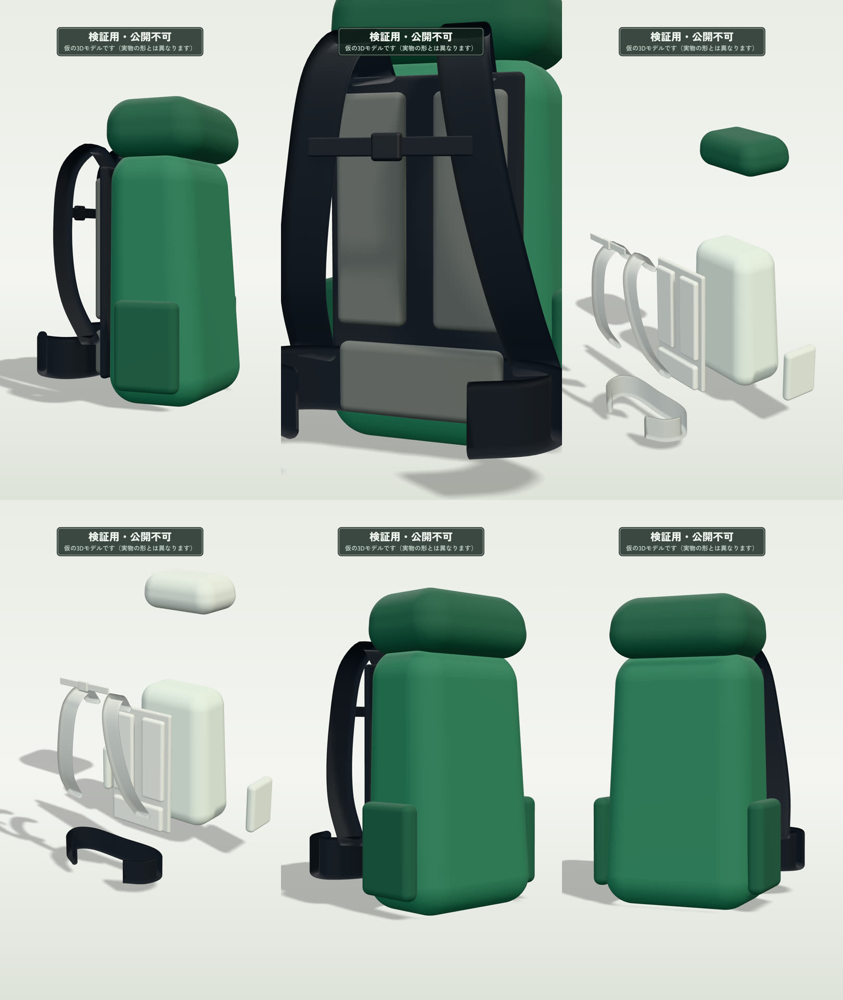

# Phase 1 の結果：書き出しの芯

- 実施日：2026-11-13
- 範囲：プロジェクトの土台、タイムラインの計算、仮のザック、`renderAt(t)`、書き出しコマンド（映像のみ）
- 結論：**30秒・900フレームのMP4を書き出せ、仕様どおりであること、同じ入力から同じフレームが出ることを確認しました。**

## 1. 成果物

| 成果物 | 場所 |
|---|---|
| 無音・透かし入りの30秒MP4 | `out/yamafit_SAMPLE-30_20261113.mp4`（Gitには入れていません。書き出し直すと同じものができます） |
| 6時点の静止画 | 下の画像（`docs/images/phase1-stills.jpg`） |
| 検証結果と全フレームのハッシュ値 | `out/yamafit_SAMPLE-30_20261113.report.json` |
| 再現性の確認結果 | `out/verify-report.json` |



左上から順に、2.5秒（全体像）、8.0秒（背面パネルへ接近）、14.5秒（分解・雨蓋を紹介）、19.0秒（分解・ヒップベルトを紹介）、24.5秒（再組み立て後の1回転）、28.5秒（まとめ）。

題材は架空の「サンプルザック 30」です。**3Dは仮モデルで、実物の形とは異なります。**

## 2. 書き出したMP4の検証（ffprobe）

| 項目 | 基準 | 結果 | 判定 |
|---|---|---|---|
| 解像度 | 1080×1920 | 1080×1920 | ○ |
| 映像コーデック | H.264 | h264（High プロファイル、レベル 4.2） | ○ |
| 画素形式 | yuv420p | yuv420p | ○ |
| 色空間 | BT.709 | bt709 | ○ |
| フレームレート | 30fps | 30/1 | ○ |
| フレーム数 | 900 | 900 | ○ |
| 尺 | 30.0秒±0.1秒 | 30.000秒 | ○ |
| faststart | あり | あり | ○ |
| ファイルサイズ | 目安 10〜25MB（音声込み） | 8.0MB（映像のみ、約2.1Mbps） | — |

色の確認：書き出し前の画像とMP4から取り出したフレームで、本体・背景・ストラップの色を比べ、差は RGB 各 0〜3 でした（H.264 への変換で生じる通常の範囲）。

## 3. 再現性の確認

`npm run verify -- examples/sample-pack` の結果です。

| 確認 | 内容 | 結果 |
|---|---|---|
| 2回の書き出しが一致するか | ブラウザを起動し直して全900フレームを2回描き、ハッシュ値を比較 | **900フレームすべて一致**（不一致 0） |
| 描く順番に依存しないか | 12フレームだけを、ばらばらの順番で描いて比較 | **12フレームすべて一致**（不一致 0） |

同じ環境（同じ Chromium、ソフトウェア描画）での結果です。MacのGPU描画とは画素単位では一致しません（計画書 3.2節）。

## 4. 所要時間

| 項目 | 結果 |
|---|---|
| 環境 | この開発用クラウド環境（4 vCPU、GPUなし、ソフトウェア描画）。GitHub Actions の公開リポジトリ向け標準ランナーとほぼ同じ規模 |
| 900フレームの書き出し | 355秒（約5分55秒） |
| 1フレームあたり | 394ミリ秒 |

計画書で立てた目標（クラウド書き出し15分以内、うち描画6〜9分）の範囲に収まっています。
文字の合成（Phase 2）と音声の合成（Phase 3）が加わると少し延びる見込みです。

Macでの計測は未実施です。Macで次を実行すると、所要時間が表示されます。

```sh
cd tools/yamafit-video
npm install
npx playwright install chromium
npm run export -- examples/sample-pack
```

## 5. テスト

| 種類 | 件数 | 結果 | 主な内容 |
|---|---|---|---|
| ユニットテスト（`npm test`） | 41 | すべて合格 | シーンの境目で動きが飛ばない／再組み立て後に完全に元の位置へ戻る／未登録・未確認のパーツが出ない／分解中も全パーツが画面に収まる／入力チェック／ファイル名 |
| 書き出しのE2Eテスト（`npm run test:e2e`） | 3 | すべて合格 | 実際に書き出して ffprobe で検証／順番を変えても同じフレーム／誤りのあるデータは分かる文で止まる |
| 型チェック（`npm run typecheck`） | — | エラーなし | — |

## 6. 受け入れ基準（計画書13章）との対応

| # | 基準 | Phase 1 時点 |
|---|---|---|
| 1 | 1080×1920、30fps、900フレーム、H.264、yuv420p | 達成 |
| 2 | 音声がAACで入っている | Phase 3 |
| 3 | 尺が30.0秒±0.1秒 | 達成（30.000秒） |
| 4 | faststart | 達成 |
| 5 | 同じ入力から同じフレームが出る | 達成（全900フレーム） |
| 6 | 順番を変えて描いても同じ絵になる | 達成 |
| 7 | 各シーンが仕様どおり | 3Dの動きは実装済み。文字を含めた確認表は Phase 2 |
| 8 | ナレーションが各シーンに収まる | Phase 3 |
| 9 | 未登録・未確認のパーツが映らない | 達成（自動テスト） |
| 10 | 原稿に入力以外の事実が入らない | Phase 3 |
| 11 | クラウド書き出しが15分以内 | 描画時間は確認済み。GitHub Actions での実行は Phase 5 |
| 12 | iPhoneとブラウザで再生できる | **ご確認をお願いします**（お送りしたMP4をiPhoneで再生） |
| 13 | エラーが分かる文で出る | 入力の誤りは実装済み。残りは Phase 3〜5 |

## 7. 実際の映像を見て決めたこと・変えたこと

- **全体を映す距離の初期値を 2.6 から 3.1 に変更。** 縦長の画面は横が狭く、2.6 では回転中にショルダーハーネスが画面からはみ出しました。
- **回転の軸を、上から見た全体の中心に置いた。** 本体の中心を軸にすると、背面側の部品が大きく振れて画面からはみ出しやすいためです。
- **接近するときは、パーツ全体が収まる距離より近くには寄らない。** 近すぎると何のパーツか分からなくなりました。
- **分解は、背面の斜め横から見せる。** 正面寄りから見ると、背面側の部品（背面パネル、ハーネス、ベルト）が本体の陰に隠れました。
- **分解の向きは、上下方向を多めに使う。** 縦長の画面では、横に広げると全体が小さくなるためです。
- **分解中は、モデル全体を少し持ち上げる。** 下向きに動くヒップベルトが床にめり込まないようにするためです（持ち上げ量は自動計算）。
- **紹介中でないパーツは、背景に近い色にする。** 半透明にすると重なりの描画が乱れやすいため、色を薄くする方法にしました。
- **トーンマッピングは PBR Neutral を使う。** 商品の色が変わりにくい方式です（入力の本体色 `#2F6B4F` に対し、照明が当たった状態で近い緑になることを確認）。
- **フレームの受け渡しは PNG。** 無圧縮の画素を送る方法より3倍以上速く、可逆なので画質は落ちません。

## 8. まだできていないこと（次のフェーズ）

- 文字（商品名、特徴、パーツ名と役割、引き出し線）、ロゴ、セーフエリアの調整 → Phase 2
- 仮モデルの質感（布地の細かい凹凸など）の作り込み → Phase 2 で検討
- ナレーション、BGM → Phase 3
- 管理画面 → Phase 4
- GitHub Actions での書き出し → Phase 5
- 商品別モデル（glb）の読み込み → Phase 6
