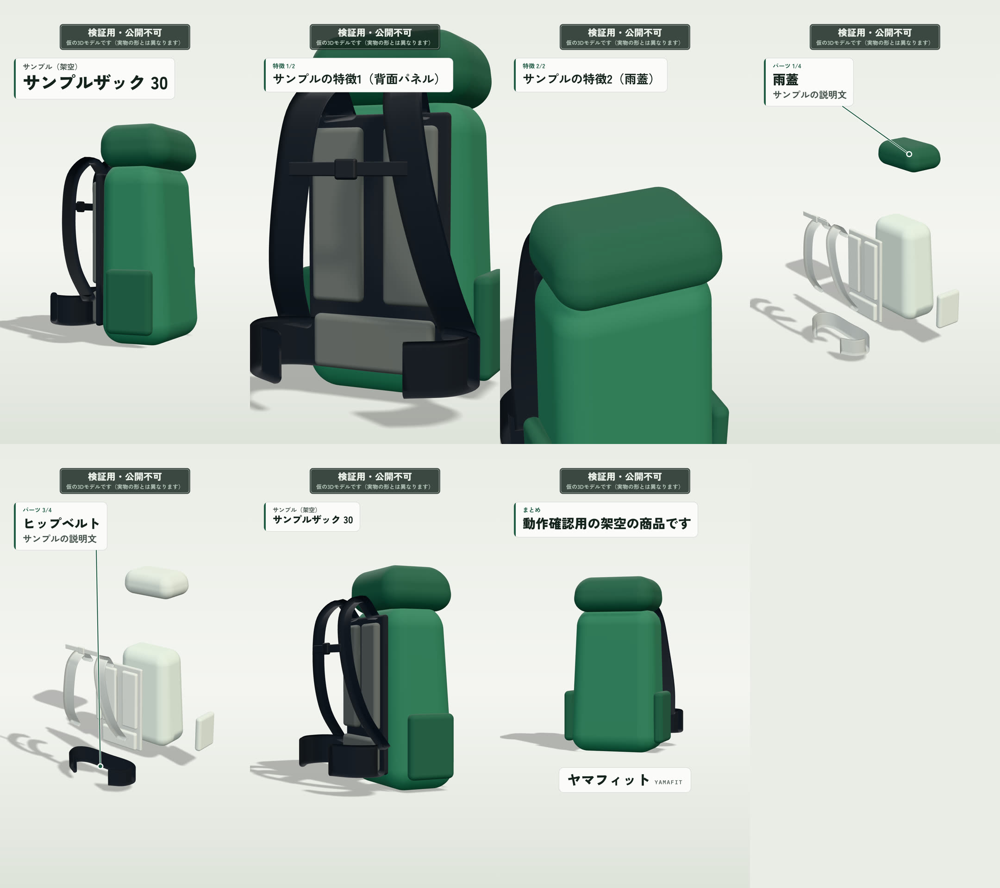

# Phase 2 の結果：文字とロゴ

- 実施日：2026-11-14
- 範囲：5シーンの演出、文字の焼き込み、引き出し線、仮のロゴ、透かし、セーフエリア
- 結論：**商品名・特徴・パーツ名と役割・まとめ・ロゴが入った30秒のMP4を書き出せました。文字がセーフエリアの中に収まり、互いに重ならないことを自動で確かめています。**

## 1. 成果物

| 成果物 | 場所 |
|---|---|
| 文字入りの30秒MP4（サンプル＝架空の商品） | `out/phase2/sample.mp4` |
| 文字入りの30秒MP4（サロモン TRAILBLAZER 10） | `out/phase2/trailblazer10.mp4` |
| 確認表 | [CHECKLIST.md](CHECKLIST.md) |
| 7時点の静止画（サンプル） | 下の画像（`docs/images/phase2-stills.jpg`） |

`out/` の中身はGitに入れていません（書き出し直すと同じものができます）。
TRAILBLAZER 10 の静止画は、公式の商品写真が写り込むため、リポジトリには入れていません。

左上から順に、2.5秒（商品名）、7.0秒（特徴1）、10.5秒（特徴2）、14.5秒（パーツ1）、18.7秒（パーツ3）、25.0秒（再組み立て後・小さい商品名）、29.9秒（まとめとロゴ）。

## 2. 入った文字

| シーン | 文字 | 位置 |
|---|---|---|
| 全体像（0〜5秒） | メーカー名、商品名 | 左上 |
| 特徴の紹介（5〜12秒） | 「特徴 1/2」＋特徴の文 | 左上 |
| 分解（12〜22秒） | 「パーツ 1/4」＋パーツ名＋役割。紹介中のパーツへ引き出し線 | 左上 |
| 再組み立て（22〜27秒） | メーカー名、商品名（小さく） | 左上 |
| まとめ（27〜30秒） | 「まとめ」＋まとめの文。下の中央にロゴ | 左上と下 |

- 文は、`project.json` に入力したものをそのまま出します。システムが足すのは「特徴 1/2」「パーツ 1/4」「まとめ」の見出しだけです。
- 役割が未入力のパーツ（TRAILBLAZER 10 の「ベルト」）は、名前だけを出します。
- ロゴは、画像がまだないので、サイトのヘッダーと同じ文字のロゴ（「ヤマフィット」＋「YAMAFIT」）です。`assets/logo/` に画像を置くと差し替わります。

## 3. 書き出したMP4の検証（ffprobe）

| 項目 | 基準 | サンプル | TRAILBLAZER 10 |
|---|---|---|---|
| 解像度 | 1080×1920 | ○ | ○ |
| 映像コーデック | H.264 | ○ | ○ |
| 画素形式 | yuv420p | ○ | ○ |
| フレームレート | 30fps | ○ | ○ |
| フレーム数 | 900 | ○ | ○ |
| 尺 | 30.0秒±0.1秒 | ○（30.000秒） | ○（30.000秒） |
| faststart | あり | ○ | ○ |
| ファイルサイズ（映像のみ） | — | 7.0MB | 7.2MB |
| 書き出し時間 | — | 374秒 | 393秒 |

書き出し時間は、この開発用クラウド環境（4 vCPU、GPUなし）での値です。文字を入れても、Phase 1（355秒）から大きくは増えていません。

## 4. 再現性の確認

`npm run verify -- projects/salomon-trailblazer-10` の結果です（文字・写真・ロゴを含む状態）。

| 確認 | 内容 | 結果 |
|---|---|---|
| 2回の書き出しが一致するか | ブラウザを起動し直して全900フレームを2回描き、ハッシュ値を比較 | **900フレームすべて一致**（不一致 0） |
| 描く順番に依存しないか | 12フレームだけを、ばらばらの順番で描いて比較 | **12フレームすべて一致**（不一致 0） |

## 5. テスト

| 種類 | 件数 | 結果 |
|---|---|---|
| ユニットテスト（`npm test`） | 86 | すべて合格 |
| 書き出しのE2Eテスト（`npm run test:e2e`） | 5 | すべて合格 |
| 型チェック（`npm run typecheck`） | — | エラーなし |

Phase 2 で増えた主なテスト：

- 文字の出し方：シーンごとの文字の内容とタイミング／入力した文以外を出さない／パーツの説明が重ならない／引き出し線の先が画面の中にある
- 文字の折り返し：禁則（行頭に「、」「。」・小さい文字・長音を置かない）／単語の切れ目で分ける／文字を落とさない／収まらなければ文字を小さくする
- 配置（実際に描いて確認）：文字・写真・ロゴがセーフエリアの中にある／互いに重ならない／入力の上限いっぱいの文字数でも枠からはみ出さない
- 3Dの位置：全体像・分解・1回転・まとめの各シーンで、商品が文字のカードやロゴにかからない
- 入力の誤り：項目の名前つきの日本語で知らせる（例「商品名：40文字以内で入力してください」）

## 6. 確認表（CHECKLIST.md）の結果

| 区分 | 項目 | 結果 |
|---|---|---|
| 全体 | A1〜A8、A10（自動） | 合格 |
| 全体 | A9 透かしが全フレームに入っている | 7時点の静止画で確認 |
| 1. 全体像 | S1-1〜S1-5 | 合格。2.5秒の静止画で、商品名のカードと「実物写真（正面）」を確認 |
| 2. 特徴の紹介 | S2-1〜S2-5 | 合格。7.0秒・10.5秒の静止画で、特徴の文、カメラの寄り、背面の写真への切り替えを確認 |
| 3. 分解 | S3-1〜S3-7 | 合格。14.5秒・18.7秒の静止画で、紹介中のパーツの色、説明のカード、引き出し線の先を確認 |
| 4. 再組み立て | S4-1〜S4-5 | 合格。25.0秒の静止画で、小さい商品名と、左右の実物写真を確認 |
| 5. まとめ | S5-1〜S5-4 | 合格。29.9秒の静止画で、まとめの文とロゴを確認 |

静止画での確認は私（開発側）が行ったものです。**動画としての見え方（文字を読む時間が足りるか、動きの速さ）は、実際に再生してご確認をお願いします。**

## 7. 実際の映像を見て決めたこと・変えたこと

- **文字には必ず白い下地を敷く。** 黒い商品に寄ったとき、下地がないと文字が読めませんでした。
- **文字のカードは、すべて左上の同じ場所に出す。** シーンが変わっても目線を動かさずに読めます。
- **3Dを、画面の中で少し下にずらし、少し小さくした。** 上の文字のカードにかからないようにするためです（「全体を映す距離」の初期値を 3.1 → 3.8 に変更）。
- **再組み立て後の1回転では、写真のカードがあるとき、商品を上に寄せて小さくする。** 回っている商品が、左右下の写真に隠れないようにするためです。
- **まとめでは、商品を引いて小さくする。** 上のまとめの文と、下のロゴの間に収めるためです。
- **引き出し線は、左右一対のパーツでは見えている側を指す。** 最初は、本体の陰に隠れた側のポケットを指していました。
- **パーツを紹介している間、カメラはほとんど動かさない。** カメラをパーツへ寄せる動きを大きくすると、3Dが文字のカードにかかりました。
- **分解の全景へカメラが引く動きを、0.5秒長くした。** 一気に引くと速すぎたためです。
- **入力の誤りの文を、分かりやすい日本語にした。** 検証ライブラリの既定の文（「大きすぎる値: string は…」）は分かりにくかったためです。

## 8. まだできていないこと（次のフェーズ）

- ナレーション（VOICEVOX）、BGM、音量の調整 → Phase 3
- VOICEVOX のクレジット表記を動画に入れる → Phase 3
- ロゴの画像への差し替え → 画像をいただき次第
- 文字を読む時間が足りるかの調整 → ナレーションの長さと合わせて Phase 3 で確認
- 管理画面 → Phase 4
- GitHub Actions での書き出し → Phase 5
